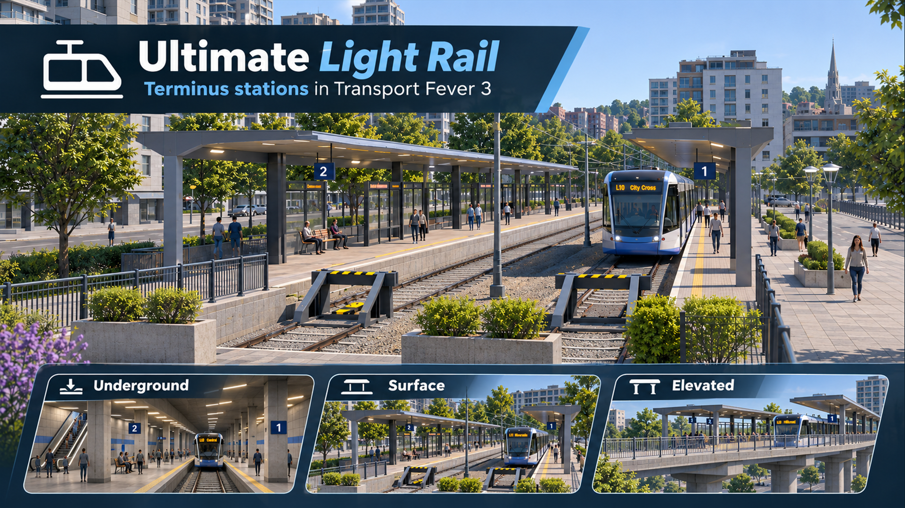
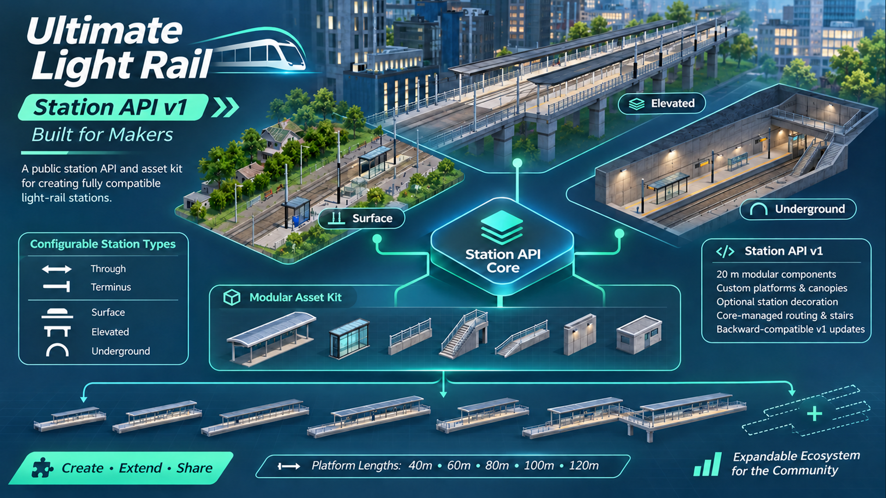
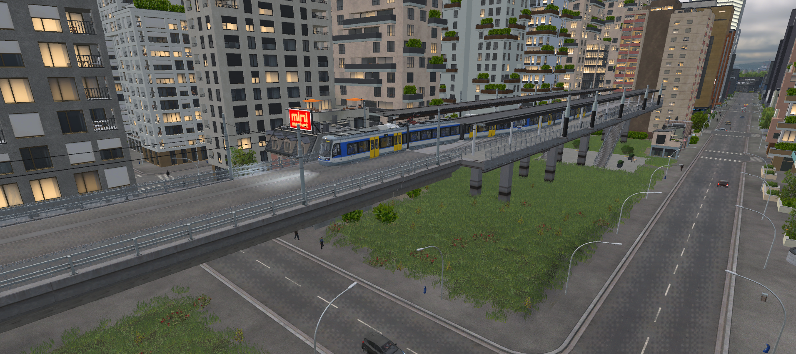
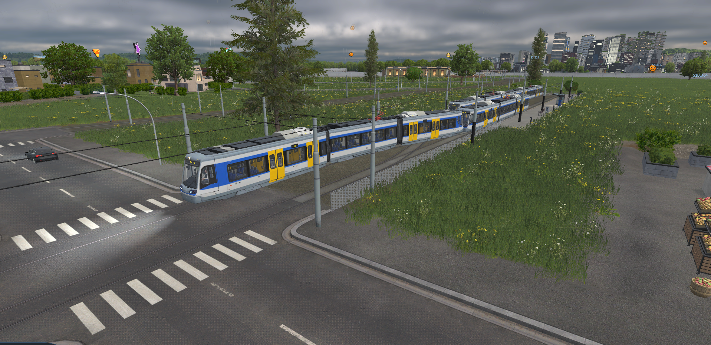

## Your city. Your light rail.

Take your tram network underground, keep it at street level, or carry it above the city. Build proper passenger stations and reversing termini, all from a dedicated **Light Rail** construction menu.

- **Three locations:** Underground, Surface and Elevated.

- **Two layouts:** through stations and termini with an integrated scissors crossover.

- **Five platform lengths:** 40, 60, 80, 100 and 120 metres.

- **Native tram connections:** use your existing electric tram infrastructure and vehicles.

- **One menu:** depot, fenced light rail track, bundled stations and compatible station packs.

**Available from 1925.** Stations and fenced track follow the native modern tram track's introduction year. The native tram depot keeps its own availability dates.

## Change ends. Keep your network moving.

Terminus stations include the crossover needed for reversing operations, without a visible turning loop. Through stations keep both ends open for intermediate stops. Choose your platform length and optional approach fences; underground stations use a fixed hall, elevated stations include a concrete structure and central stair access.

## Built for players. Open to station creators.

The bundled stations use the same public **Station API v1** available to other creators. Supply your platform and canopy models on the **20m component grid**, choose shelters and decoration, or omit optional elements. Your station pack appears in the same Light Rail menu.

The core manages the two-track layout, terminals, crossovers, entrances, stairs and pedestrian routing. API v1 keeps those positions fixed; it does not support arbitrary stair placement, additional tracks or custom underground-hall models.

**A stable dependency:** updates and extensions within the documented API v1 contract remain backward compatible. Breaking changes will introduce a new API version alongside v1. Existing conforming v1 station packs remain supported.

[Download the developer kit](https://github.com/MrNickert/ultimate-light-rail/releases/download/v1.0.0/ultimate-light-rail-developer-kit-1.0.0.zip) · [Download the example station pack](https://github.com/MrNickert/ultimate-light-rail/releases/download/v1.0.0/ultimate-light-rail-contract-example-1.0.0.zip) · [Read the API documentation](https://github.com/MrNickert/ultimate-light-rail/blob/main/docs/station-api-v1.md)

## In the game

The cover and API overview are illustrative promotional artwork. These two screenshots show the current in-game assets.

## Start building

- Enable Ultimate Light Rail and load your game.

- Open **Light Rail** between Road and Rail on the construction bar.

- Place a station, connect electric tram track and a tram depot.

- Create a line and assign tram vehicles that fit the platform length.

Select terminals or add waypoints when you need a particular track assignment. Overlong vehicles can keep a terminus crossover occupied. No additional vehicle fleet is included.

## Compatibility and credits

Keep Ultimate Light Rail and any required station packs enabled while their infrastructure is present in your save. Mods replacing the same native construction UI may conflict. Development-save migration and console compatibility are not promised.

Created by **MrNickert**. Station assemblies reference installed Transport Fever 3 assets by Urban Games. No native texture, mesh or material binaries are redistributed. [Source, documentation and downloads](https://github.com/MrNickert/ultimate-light-rail).
